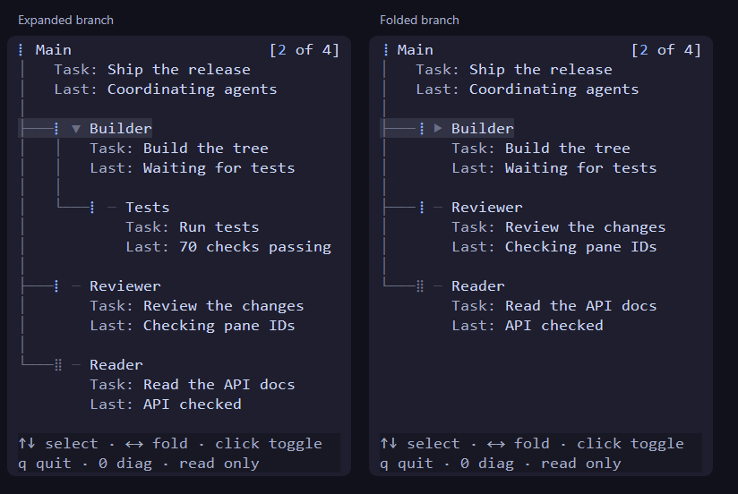

<h1 align="center">Codex Subagents</h1>

<p align="center">
  <b>See what your Codex agents are doing, without leaving Herdr.</b>
</p>

<p align="center">
  <a href="https://github.com/sm-steel/herdr-codex-subagents-rs/actions/workflows/ci.yml"></a>
  <a href="https://github.com/sm-steel/herdr-codex-subagents-rs/actions/workflows/release.yml"></a>
  <br>
  📖 <a href="docs/usage.md">Guide</a> ·
  📦 <a href="docs/install.md">Installation</a> ·
  🤖 <a href="INSTALL.md">For agents</a>
</p>

<p align="center">
  
  <br>
  <sub>Real panel rendering, synthetic demo sessions.</sub>
</p>

## How it works

The plugin opens a small panel beside Codex and follows its local session logs.
Main stays at the top; delegated agents form a tree underneath. Expand a branch
to see its children, task and latest activity. Your original Codex TUI stays in
its own pane.

## Features

- 🌳 **One tree** for Main, subagents and nested work
- ⣿ **Live indicators** that animate while an agent or its descendants work
- 🕒 **Working first, then last active**, with a working/total counter
- ⌨️ **Keyboard and mouse** to select, expand and fold branches
- 🎨 **Catppuccin Mocha**, a compact 36-column panel and no focus stealing
- 🔒 **Local and read-only**: no API keys, model calls or telemetry

## Install

You need [Herdr 0.9.5+](https://herdr.dev/) and Codex. The default installer uses
a prebuilt binary; Rust and Git are unnecessary.

**Linux — Ubuntu or Arch, x86-64**

```sh
curl -fsSL https://github.com/sm-steel/herdr-codex-subagents-rs/releases/latest/download/install.sh | sh
```

**Windows — x86-64**

```powershell
powershell -ExecutionPolicy Bypass -c "irm https://github.com/sm-steel/herdr-codex-subagents-rs/releases/latest/download/install.ps1 | iex"
```

Review the hook once in Codex `/hooks`. Later sessions attach automatically.
[Installation](docs/install.md) covers source builds and updates.
You can also ask your agent: “Install this for me:
https://github.com/sm-steel/herdr-codex-subagents-rs”.

## Development

You need Rust 1.99.0 and [mise](https://mise.jdx.dev/).

```sh
mise install
mise run check
```

See the [design](docs/design.md), [Rust conventions](docs/rust-rules.md) and
[platform checks](docs/compatibility.md). Versions and releases use
[Cocogitto through mise tasks](docs/packaging.md).

## License

[MIT](LICENSE-MIT) OR [Apache-2.0](LICENSE-APACHE).
