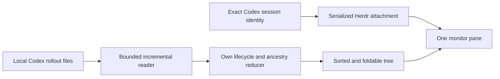

# Design: automatic Codex agent tree for Herdr TUI

## Behavior

One read-only panel lists Main and all known descendants. Main stays pinned first.
Active sibling branches sort before inactive ones, preserving stable ordering
within each group and keeping descendants beneath their actual parent.

The first row shows a loading icon and Main at the left, with `[N of X]` aligned
to the right. N counts descendants whose own recorded status is working; X counts
all known descendants, including folded ones. An active N uses the same Mocha blue
as the animated icon. There is no separate header or outer tree border.

Every icon precedes its name with one following space, no leading margin, and
no gap between its tree connector and icon. Working branches use
all four Braille rows: `⡀ ⡄ ⡆ ⡇ ⣇ ⣧ ⣷ ⣿ ⢿ ⢻ ⢹ ⢸ ⠸ ⠘ ⠈ ⠀`. A branch animates if
its own turn or any descendant is working. Other branches use a static gray `⣿`.
The reducer and JSON observation retain distinct own lifecycle states; the UI
uses the simplified icons requested for this panel.

Gray tree connectors continue beneath each node's icon through its task/activity
lines to its descendants. All panel colors come from Catppuccin Mocha. The footer
has a separate background and exactly two rows. New panels default to 36 columns
where Herdr's layout constraints permit; later resizing follows host split ratios.

Up/down selects a row. Left collapses or selects its parent; right expands or
selects its first child. Enter/Space or a mouse click toggles a branch. Folding
preserves its activity indicator and does not change the counter. Selection tracks
thread identity through sorting. Main remains pinned while children scroll.
`q`/Ctrl-C closes only the monitor; terminal mouse capture is restored on exit.

## Observation and attachment

The Rust SessionStart hook reports exact identity through Herdr's native protocol,
then reconciles monitors. Setup preserves other hooks and requires Codex's normal
human trust review. Startup, detection, status and move events also reconcile.
Existing resumed sessions can use an unambiguous `codex resume <UUID>` argument.
Fresh sessions without either identity remain untouched; never guess by directory
or recency. Parent identity remains the original root while Codex displays a child.

A file lock serializes attachment. The registry verifies both source and monitor
terminal identities. A durable pending attempt precedes pane creation, suppressing
duplicates after ambiguous host failures. Unknown host errors are propagated rather
than interpreted as absence. Moving a source reuses its monitor, which may remain
in its original tab. Setup serializes its own config changes and checks for outside
edits before replacing hooks.json.

The reader supports partial UTF-8/JSONL, bounded records and polling, replacements,
ancestry, exact call-ID task attribution and late turn events. Lifecycle reflects
recorded events; quiet logs never imply completion. Missing sources remain stale.
Task and activity stay separate; missing data remains unavailable. Terminal control
sequences are removed before rendering. No credentials, telemetry or model calls.

## Deferred navigation

Selecting or folding a row never switches Codex threads or sends it input. One-click
thread switching remains deferred until an atomic safe host operation is available.
The successful exploratory navigation spike is documented in [the PoC](../poc/RESULTS.md).

Windows and Linux are required. Engineering rules are in [rust-rules.md](rust-rules.md).

Main starts expanded; nested subagent branches start collapsed. Expanding a branch
keeps it expanded across updates. Hidden descendants still affect icons and counts.
