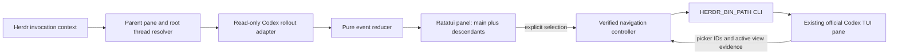

# Design: one panel, existing Codex pane

## Current implementation scope

The first version is monitoring only. Thread switching is disabled until safe
atomic control is established. The navigation sections below describe deferred
work; they are not acceptance requirements for the monitoring preview.

## Intent and status

Make delegated work visible while preserving the official Codex TUI. Windows
and Linux are required platforms. This is a proposed design for review, with a
successful Windows navigation spike; Linux has not yet been tested.

The user selected one panel and specified main-first ordering and click-to-switch
in the existing Codex pane. Other implementation decisions below are proposals.

## Behavior

- Main is always first. Descendants follow in stable first-seen order, indented
  by ancestry, with a bounded scrollable list. Parent remains the original root
  even while Codex displays a child.
- Every row has a status icon, readable status text, name, assignment preview,
  and latest observable activity. Main and child rows share the same status model.
- Working uses an animated spinner while the panel is visible; text/ASCII fallback
  is `* working`. Waiting is `~ waiting`, completed is `+ completed`, failed is
  `! failed`, idle is `- idle`, and unknown is `? unknown`. Closed is distinct
  from completed. Color is supplementary, never the sole signal.
- Main's own status is separate from its descendant rollup: e.g. `idle; 2 children
  working`. Do not call main working merely because a child is working.
- A click or keyboard Enter requests navigation in the original Codex pane.
  Highlight changes only after verified success. Keep parent return always visible.
- Retain completed rows for review; do not auto-close panes or hide rows immediately.
- Task means recorded assignment or latest explicit plan; activity means an
  observed tool/message event. Missing values say unavailable rather than guessing.
- Keep panel and main pane side by side; do not create one pane per child.

## Approaches

| Option | Fit and tradeoff |
| --- | --- |
| Rollout reader + Herdr CLI navigation | Proposed first version; works with ordinary sessions, but rollout format and TUI navigation need versioned compatibility checks. |
| Shared app-server observer + Herdr navigation | Structured live events; needs proof of same-server attachment, observation without configuration changes, and child subscriptions. Future adapter, not assumed available. |
| Custom/forked Codex TUI | Would permit a direct thread-select channel; substantial maintenance and replaces the stock binary. Not selected. |

One compact panel is confirmed. The rollout-first adapter remains a recommendation
pending review; no direct external select-thread RPC has been established.

## Components

Start with one Cargo package containing a library and thin executable. Modules
follow domains: `session`, `agent`, `rollout`, `herdr`, `navigation`, `panel`, and
`diagnostics`. Avoid speculative workspace crates and Tokio until measured need.
Use Ratatui/Crossterm for rendering/input; a synchronous reducer and bounded
worker messages isolate I/O. Workers have explicit cancellation and join on exit.

## Discovery and observation

Resolve the source pane from invocation context captured before the viewer opens.
Herdr context may identify the viewer itself after launch: never reinterpret that
as the source. Prefer Herdr's recorded Codex session identity. If absent, request
an explicit root thread ID; never pick the newest session or cwd match silently.

Respect `CODEX_HOME` and platform-native home lookup. Read session rollouts only,
not credentials or the state database. Version fixture envelopes from Codex
0.166.0 and tolerate additive fields/unknown event kinds. Use exact thread IDs,
parent relations, and delegation call IDs. Names and paths are presentation only.

Index metadata once, then incrementally tail relevant files. First version uses
bounded metadata polling (500 ms active, 2 s discovery); avoid recursively watching
the entire home. Store offsets as bytes, buffer partial UTF-8/JSONL lines, and
handle truncation, replacement, compaction, restart, and late child creation.
Caps: 1 MiB per record, 1,000 displayed agents, 200 retained activities per agent,
4 KiB display text per activity. Oversize records are skipped with diagnostics.
Limits are proposed, configurable only with documented bounds.

Lifecycle evidence must be characterized against real v1/v2 rollout examples.
Turn-start means working until a matching stop/completion/failure/interruption
event. Explicit tool/approval/user waits refine waiting; pending delegation is
separate from parent activity. Quiet files do not mean completion. After loss of
source freshness, retain last known status with `stale` rather than inventing it.
Persisted history alone cannot prove a process is still alive: show provenance
and freshness. Root and child state use identical reducer rules.

## Navigation contract and limits

The Windows spike proves main-to-child picker selection and child-to-main
`Alt+Left` in the same Codex process. It does not prove arbitrary thread targeting
is reliable under all UI states. The app-server manages threads; the TUI owns
which one is displayed. Reading/resuming through an RPC is not proof of switching
an already running TUI.

The production controller must:

1. Pin server/session, pane ID, root thread ID, and expected Codex version.
2. Recheck pane process and rendered UI; serialize navigation requests.
3. Refuse navigation while drafts, overlays, approval prompts, or uncertain state
   make input ambiguous. Never clear drafts or dismiss approvals automatically.
4. Refresh `/subagents` only from a confirmed empty, writable main composer.
   Read its exact row thread IDs and current marker; never use a guessed row order.
5. Select the verified target row or use observed built-in adjacent navigation
   with a bounded number of steps. Wait for redraw and independently verify.
6. Stop on missing, duplicate, truncated, or changed identity. Show an actionable
   error; never submit a prompt, resume another process, or claim success.

Picker parsing and verification are a release-blocking PoC: if full UUID identity
cannot be verified for a target, offer the native picker rather than a false
one-click guarantee. Long lists, narrow panes, duplicate names, dead children,
manual navigation, remapped bindings, and user typing races need explicit tests.
An input race cannot be eliminated with screen scraping. Safe one-click switching
requires a proven input-exclusion mechanism or upstream atomic TUI control before
release; refusal based on a prior screenshot alone is insufficient. Document the remaining
limitation and seek an upstream TUI select-thread API if needed.

## Platform and lifecycle

All Herdr calls use `Command` argv via `HERDR_BIN_PATH`, never shell command
strings. This delegates named pipes and Unix sockets to Herdr. Resolve executable
suffixes and paths with `PathBuf`/`OsString`; support spaces and Unicode. Separate
Windows/Linux manifest commands if `.exe` paths require them. Verify manifest
fields against installed 0.9.5, not newer website examples.

Minimum initial test baseline: Herdr 0.9.5 / Codex 0.166.0. Declare broader support
only after testing. Remote SSH observation runs on the host owning the files;
cross-host file access and macOS are outside the first release.

The panel owns its workers and exits cleanly on q/Ctrl-C/pane close, restoring
terminal modes. No detached daemon. Only plugin-owned resources may be cleaned
up. Updating/uninstalling never stops a Codex session.

## Privacy and failures

No model calls, authentication, network telemetry, or prompt submission. Never
log raw assignments, messages, tool arguments, output, env values, or auth files.
Showing local conversation text is intentional; diagnostics retain IDs, event
kinds, offsets, counts, and sanitized error categories. Strip terminal control
characters and OSC sequences before display. Sanitization is not a guarantee
that arbitrary task text contains no secrets; never persist it in debug logs.

| Failure | Required outcome |
| --- | --- |
| Unknown source session | Ask for root ID; do not guess by cwd. |
| Child file not created yet | Keep pending child; retry bounded discovery. |
| Unknown schema | Mark unsupported/unknown; other rows continue. |
| Stale or unreadable source | Preserve last known state with stale marker. |
| Codex pane replaced/closed | Disable navigation immediately. |
| Draft/modal/racing user input | Refuse or abort; leave content untouched. |
| Source error in one child | Isolate its diagnostic; retain main and siblings. |
| Viewer closes | Restore terminal, stop workers; Codex continues. |

## Acceptance gates

- Real Windows and Linux smoke tests with a parent and two children, including
  active, waiting, completed, failed/interrupted and stale evidence.
- Clicking main and each child switches the original pane, verifies identity,
  leaves draft/approval input untouched, and never starts another Codex process.
- Resumed roots and pre-existing children are discovered without cwd guessing.
- Bounded memory/record handling on large histories; idle files avoid repeated
  whole-file parsing; no model/API usage from monitoring or navigation.
- Unit/property/fixture tests for reducers, JSONL boundaries, status, sanitization;
  fake Herdr executable tests for argv and race failures; real host smoke tests.
- Formatter, strict Clippy, tests, dependency/license audit, and Windows/Linux CI
  pass before any release is called supported.
